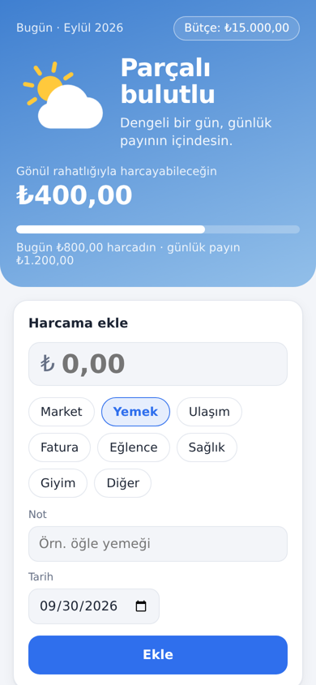
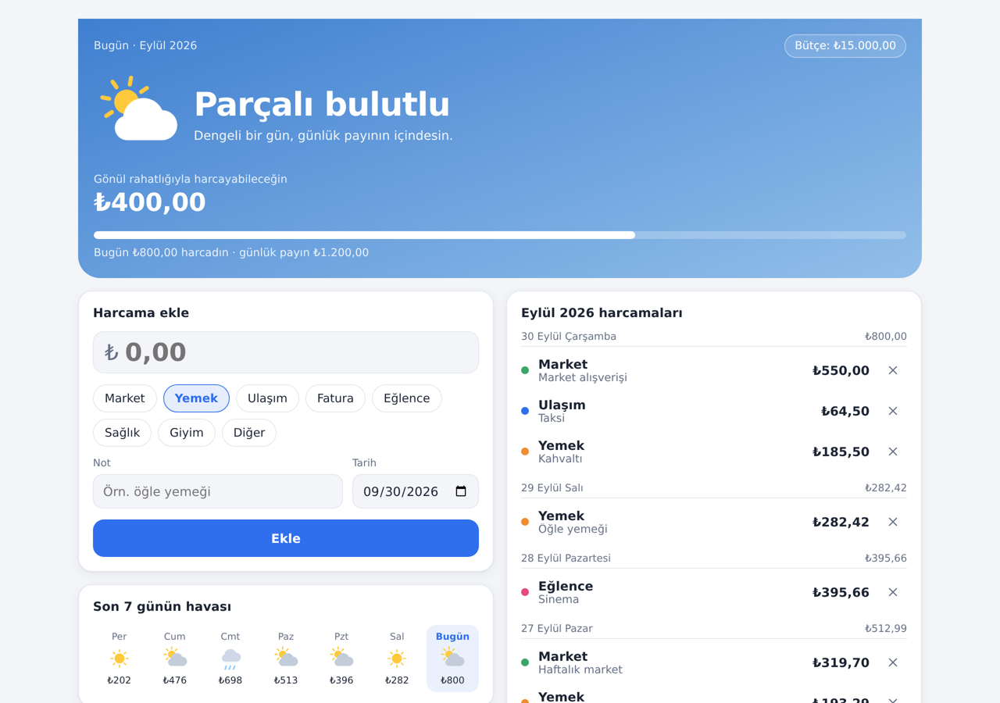
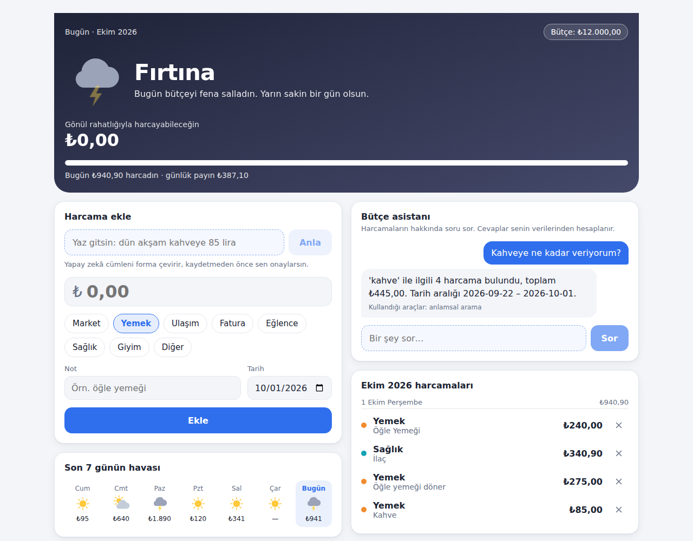

# Bütçe Hava Durumu

Harcamalarını takip et, bütçenin durumunu **hava durumu** gibi gör.
Bugün güneşli mi, fırtına mı geliyor? Grafik okumak yok, bir bakışta anlaşılır.

<p>
  
  
</p>

- **Bugünün havası:** Bugünkü harcaman, günlük payınla karşılaştırılır.
- **Gönül rahatlığıyla harcanabilir:** Hava bozulmadan bugün daha ne kadar harcayabilirsin.
- **Son 7 günün havası** ve **ay sonu tahmini.**
- Web ve mobil uyumlu PWA: telefonda "Ana ekrana ekle" ile uygulama gibi çalışır.

### Yapay zekâ özellikleri (yerel, ücretsiz: Ollama)



- **Cümleyle harcama ekleme:** "dün akşam kahveye 85 lira" yaz, form dolsun; kontrol edip kaydet.
  (LLM structured output, JSON schema)
- **Anlamsal arama:** "kahve" araması, notunda kahve geçmeyen "Starbucks latte" kaydını da bulur.
  (RAG retrieval: embedding + PostgreSQL pgvector)
- **Bütçe asistanı:** "Geçen ay en çok nereye harcadım?" diye sor; asistan araç çağırarak senin verilerinden cevaplar.
  (AI agent: tool calling, plan-act-observe döngüsü)

Tasarım kararları ve ölçümler: [`docs/prd-ai.md`](docs/prd-ai.md).

Kurallar ve kapsam: [`docs/prd.md`](docs/prd.md). Mimari standart ve review listesi: [`docs/standards.md`](docs/standards.md).

## Çalıştırma

Gereken: Docker. Yapay zekâ modelleri için en az 8 GB RAM önerilir.

```bash
docker compose up --build
```

İlk çalıştırmada `ollama-models` servisi modelleri indirir (~3 GB, bir kez). İndirme bitene kadar
yapay zekâ özellikleri "servise ulaşılamıyor" der; uygulamanın geri kalanı normal çalışır.
İlerlemeyi görmek için: `docker compose logs -f ollama-models`.

Daha güçlü bir makinede daha iyi model: `CHAT_MODEL=qwen2.5:7b AGENT_MODE=Native docker compose up`.

- Uygulama: http://localhost:8080
- API: http://localhost:5080 (sağlık: `/health`)
- Veritabanı paneli (Adminer): http://localhost:8081
- Ollama (model sunucusu): http://localhost:11434

### Veritabanını görmek

http://localhost:8081 adresinde şu bilgilerle giriş yap:

| Alan | Değer |
| --- | --- |
| System | PostgreSQL |
| Server | `postgres` |
| Username | `expense` |
| Password | `expense_dev` |
| Database | `expense_tracker` |

Tablolar: `expenses` (harcamalar), `budgets` (aylık bütçeler), `expense_embeddings` (arama vektörleri). Her kaydın `user_id` değeri,
tarayıcıdaki `expense-tracker.user-id` (F12 → Application → Local Storage) ile eşleşir.

### Geliştirme

Gereken: .NET 9 SDK, Node 22, Docker (Postgres ve entegrasyon testleri için).

```bash
docker compose up -d postgres
dotnet run --project src/ExpenseTracker.Api          # http://localhost:5080, migration'ları uygular
cd web && npm install && npm run dev                 # http://localhost:5173, /api isteklerini API'ye yönlendirir
```

Yapay zekâ için Ollama'yı ayrıca çalıştır: `docker compose up -d ollama ollama-models`
(ya da https://ollama.com kurup `ollama pull qwen2.5:3b && ollama pull bge-m3`).

### Test

```bash
dotnet build -warnaserror
dotnet test                       # Domain + validator + gerçek Postgres (pgvector) üzerinde API testleri
cd web && npm run lint && npm run build
```

Docker Hub limitine takılırsan entegrasyon testleri için farklı bir imaj verebilirsin:
`TEST_POSTGRES_IMAGE=<pgvector imajı> dotnet test`. Testler gerçek model kullanmaz;
deterministik sahte model ve embedding istemcileriyle çalışır.

## Mimari

```
src/
  ExpenseTracker.Domain          Entity'ler, hava durumu hesabı (saf, paketsiz)
  ExpenseTracker.Application     CQRS (MediatR), FluentValidation, use case'ler, prompt'lar, ajan araçları
  ExpenseTracker.Infrastructure  EF Core + PostgreSQL/pgvector, Ollama istemcileri, embedding indexleyici
  ExpenseTracker.Api             Controller'lar, kullanıcı middleware'i, ProblemDetails
tests/                           Domain, Application ve API entegrasyon testleri
web/                             React + Vite + TypeScript PWA
```

MVP'de giriş yok: tarayıcı rastgele bir kullanıcı kimliği üretir ve `X-User-Id` header'ıyla gönderir.
Bu bir parola değildir; gerçek kullanıcılar için kimlik doğrulama sonraki aşamada eklenecek.

## Claude ile çalışma

`CLAUDE.md` proje kurallarını ve "bitti" tanımını içerir. `.claude/agents/` altında
`architect`, `implementer` ve `reviewer` alt ajanları, `.claude/commands/review.md` altında
`/review` komutu var.
