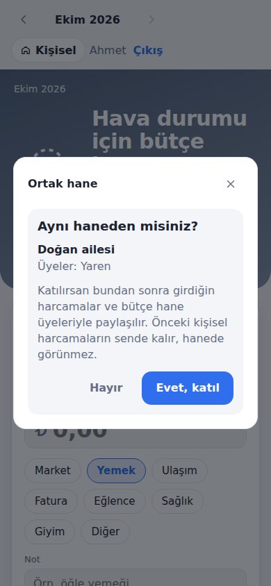
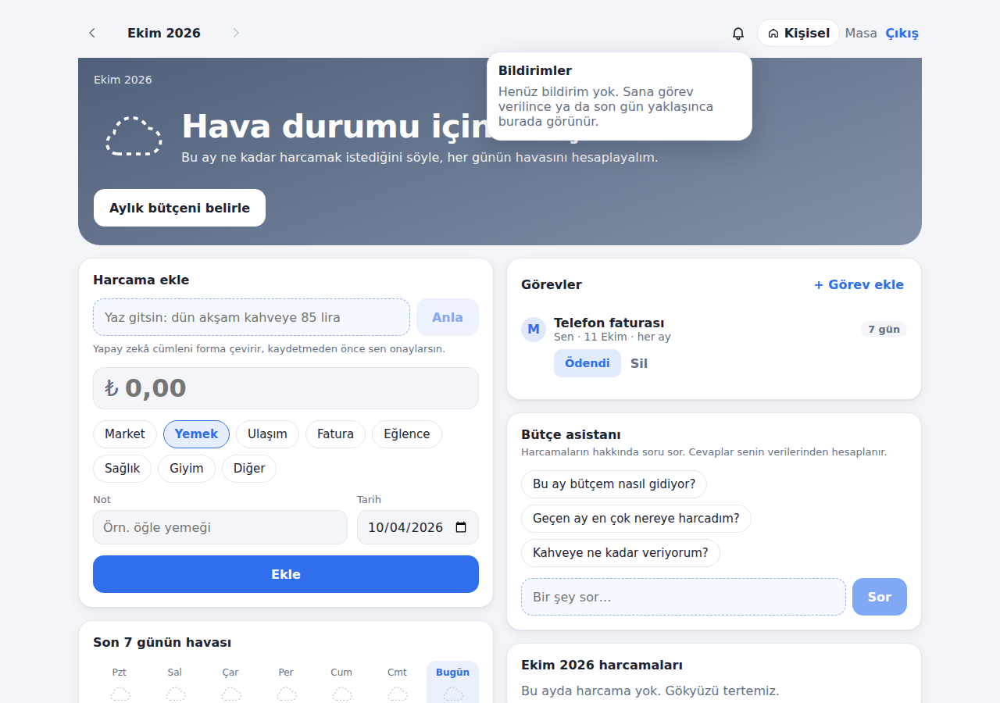

# Bütçe Hava Durumu

Harcamalarını takip et, bütçenin durumunu **hava durumu** gibi gör.
Bugün güneşli mi, fırtına mı geliyor? Grafik okumak yok, bir bakışta anlaşılır.

<p>
  
  
</p>

- **Bugünün havası:** Bugünkü harcaman, günlük payınla karşılaştırılır.
- **Gönül rahatlığıyla harcanabilir:** Hava bozulmadan bugün daha ne kadar harcayabilirsin.
- **Son 7 günün havası** ve **ay sonu tahmini.**
- **Geçmiş aylar:** Önceki aylara gidip harcama ve bütçe girebilir, ayın nasıl kapandığını görebilirsin.
- **Ortak hane:** Eşinle ya da ailenle aynı bütçeyi ve harcama listesini paylaş. Davet koduyla katılırken
  "Aynı haneden misiniz?" diye sorulur; herkes tüm harcamaları görür, sadece kendi girdiğini siler.
  <br>
- **Görevler ve bildirimler:** Faturaları hane üyelerine ata ("İnternet faturası → Ahmet"), her ay tekrarlasın.
  Görevi alana bildirim gider, son gün yaklaşınca hatırlatılır; "Ödendi" deyip tutarı yazınca harcama olarak eklenir.
  <br>
- **Ay değerlendirmesi (ajan):** Ay bitince ajan ayı inceler; öne çıkanları ve bir tavsiyeyi yazar, haneye bildirir.
- **Birikim planlayıcı (ajan):** "6 ayda ₺20.000" hedefi için hangi kalemlerden kısılacağını ve aylık bütçeyi önerir;
  onaylayınca uygulanır. İki ajanda da sayıları kod hesaplar, model yoksa kurallarla çalışır.
- **Hesap:** E-posta ve şifreyle kayıt/giriş. Oturum HttpOnly cookie'de tutulur.
- Web ve mobil uyumlu PWA: telefonda "Ana ekrana ekle" ile uygulama gibi çalışır.

### Yapay zekâ özellikleri (ücretsiz: Gemini API ya da yerel Ollama)


- **Cümleyle harcama ekleme:** "dün akşam kahveye 85 lira" yaz, form dolsun; kontrol edip kaydet.
  (LLM structured output, JSON schema)
- **Anlamsal arama:** "kahve" araması, notunda kahve geçmeyen "Starbucks latte" kaydını da bulur.
  (RAG retrieval: embedding + PostgreSQL pgvector)
- **Bütçe asistanı:** "Geçen ay en çok nereye harcadım?" diye sor; asistan araç çağırarak senin verilerinden cevaplar.
  (AI agent: tool calling, plan-act-observe döngüsü)

Tasarım kararları ve ölçümler: [`docs/prd-ai.md`](docs/prd-ai.md).

**Kılavuz (PDF):** [`docs/Butce-Hava-Durumu-Kilavuz.pdf`](docs/Butce-Hava-Durumu-Kilavuz.pdf): kullanım, kurulum, mimari, güvenlik,
yapay zekâ, veritabanı ve API. Veritabanındaki her tablo ve kolonun Türkçe açıklaması Adminer'da da görünür.

Kurallar ve kapsam: [`docs/prd.md`](docs/prd.md). Hesaplar, geçmiş aylar ve ortak hane:
[`docs/prd-accounts.md`](docs/prd-accounts.md). Görevler ve bildirimler: [`docs/prd-tasks.md`](docs/prd-tasks.md).
Ajanlar: [`docs/prd-insights.md`](docs/prd-insights.md). Mimari standart ve review listesi: [`docs/standards.md`](docs/standards.md).

## Çalıştırma

Gereken: Docker.

1. Yapay zekâ için ücretsiz bir Gemini API anahtarı al: https://aistudio.google.com/apikey
2. `.env.example` dosyasını `.env` olarak kopyala ve anahtarı yaz (`.env` git'e eklenmez):

   ```powershell
   Copy-Item .env.example .env
   notepad .env        # AI_API_KEY=... satırını doldur
   ```

3. Başlat:

   ```bash
   docker compose up -d --build
   ```

Anahtar yoksa uygulama yine çalışır; sadece yapay zekâ özellikleri "yapılandırılmamış" der.
Gemini ücretsiz katmanında istekler dakika başına sınırlıdır ve gönderilen veriler Google tarafından
model geliştirmek için kullanılabilir; gerçek kişisel veri yerine test verisi kullan.

**Yerel model (internetsiz, ~7 GB disk):** `.env` içinde Ollama satırlarını aç
(`.env.example`'daki yorumlu bölüm) ve `docker compose --profile ollama up -d --build` ile başlat.
Modellerin inişini izlemek için: `docker compose logs -f ollama-models`.

- Uygulama: http://localhost:8080
- API: http://localhost:5080 (sağlık: `/health`)
- Veritabanı paneli (Adminer): http://localhost:8081

### Veritabanını görmek

http://localhost:8081 adresinde şu bilgilerle giriş yap:

| Alan | Değer |
| --- | --- |
| System | PostgreSQL |
| Server | `postgres` |
| Username | `expense` |
| Password | `expense_dev` |
| Database | `expense_tracker` |

Başlıca tablolar: `expenses` (harcamalar), `budgets` (aylık bütçeler), `tasks` (görevler), `notifications` (bildirimler),
`month_reviews` ve `budget_plans` (ajan çıktıları), `expense_embeddings` (arama vektörleri). Her kayıt bir deftere aittir
(`ledger_id`): kişisel defterde kullanıcının, hane defterinde hanenin kimliği. Her tablo ve kolonun Türkçe açıklaması
Adminer'da "Yorum" sütununda görünür; tam liste kılavuzun veritabanı bölümünde.

### Geliştirme

Gereken: .NET 9 SDK, Node 22, Docker (Postgres ve entegrasyon testleri için).

```bash
docker compose up -d postgres
dotnet run --project src/ExpenseTracker.Api          # http://localhost:5080, migration'ları uygular
cd web && npm install && npm run dev                 # http://localhost:5173, /api isteklerini API'ye yönlendirir
```

Yapay zekâ ayarları `appsettings.Development.json` ya da ortam değişkenleriyle verilir:
`Ai__Provider`, `Ai__Endpoint`, `Ai__ApiKey`, `Ai__ChatModel`, `Ai__EmbeddingModel`, `Ai__AgentMode`.

### Test

```bash
dotnet build -warnaserror
dotnet test                       # Domain + validator + gerçek Postgres (pgvector) üzerinde API testleri
cd web && npm run lint && npm run build
```

Docker Hub limitine takılırsan entegrasyon testleri için farklı bir imaj verebilirsin:
`TEST_POSTGRES_IMAGE=<pgvector imajı> dotnet test`. Testler gerçek model kullanmaz;
deterministik sahte model ve embedding istemcileriyle çalışır.

## Mimari

```
src/
  ExpenseTracker.Domain          Entity'ler, hava durumu hesabı (saf, paketsiz)
  ExpenseTracker.Application     CQRS (MediatR), FluentValidation, use case'ler, prompt'lar, ajan araçları
  ExpenseTracker.Infrastructure  EF Core + PostgreSQL/pgvector, model istemcileri (Ollama / OpenAI uyumlu), indexleyici
  ExpenseTracker.Api             Controller'lar, Identity cookie oturumu, defter middleware'i, ProblemDetails
tests/                           Domain, Application ve API entegrasyon testleri
web/                             React + Vite + TypeScript PWA
```

Giriş ASP.NET Core Identity ile yapılır; oturum HttpOnly, `SameSite=Strict` bir cookie'dir. Her harcama ve bütçe bir
**deftere** (`LedgerId`) aittir: hanede değilsen kişisel defterin, hanedeysen hane defteri. Tüm sorgular aktif deftere
göre filtrelenir. Hesaplardan önce bu tarayıcıda girilen veriler ilk kayıt/girişte hesaba taşınır.

## Claude ile çalışma

`CLAUDE.md` proje kurallarını ve "bitti" tanımını içerir. `.claude/agents/` altında yedi alt ajan var:
`architect` (plan), `implementer` (kod + test), `tester` (`/test-plan`), `security-reviewer` (`/security-review`),
`migration-checker` (`/check-migration`), `reviewer` (`/review`) ve `docs-keeper` (`/update-guide`).
Önerilen sıra ve her ajanın görevi: [`docs/prd-insights.md`](docs/prd-insights.md) ve kılavuzun Ajanlar bölümü.
